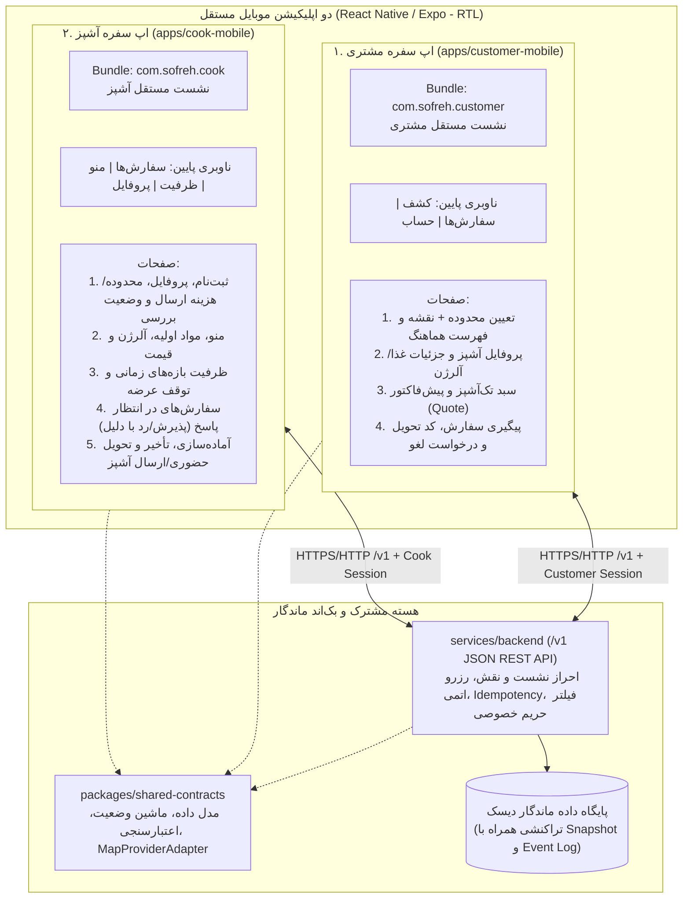
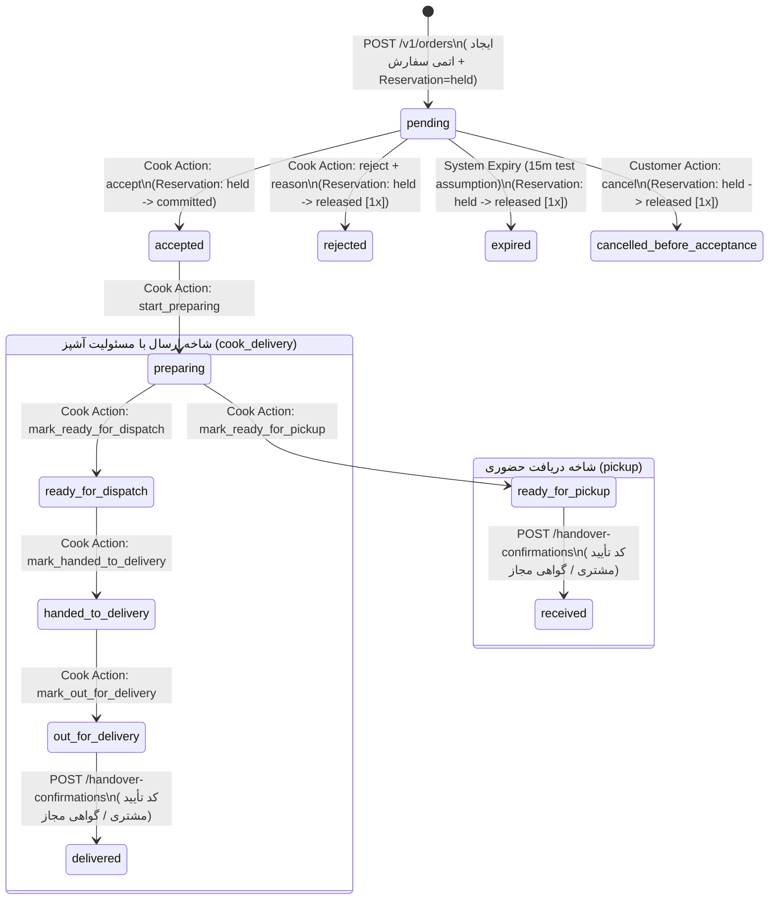

> Historical product/architecture reference (2026-10-31), not a current build/test receipt. See ../../README.md for current executable status. Machine/private operational readiness notes omitted.

# گزارش آمادگی/شکاف و برنامه اجرایی مرحله‌ای «سفره» (Sofreh v2)

- **مرجع قانونی و فنی:** [Sofreh_Product_Blueprint_FA_2026-10-31.md](./Sofreh_Product_Blueprint_FA_2026-10-31.md) (۴۸۸ خط کامل، ۸۳٬۲۱۱ بایت، مطالعه کامل)
- **مسیر فضای کاری:** `.`
- **وضعیت فعلی:** مرحله برنامه‌ریزی و گزارش آمادگی/شکاف تکمیل شد؛ هیچ فایل سورس موجودی تغییر نکرده و هیچ ساخت یا دستور مخربی اجرا نشده است.

---

## ۱. گزارش آمادگی و تحلیل شکاف (Readiness & Gap Report)

### ۱.۲ پژوهش امکان‌سنجی ارائه‌دهنده نقشه (Map Provider Feasibility Study)
طبق دستور صریح سند (خطوط ۲۵۴ و ۴۲۸)، تصویر ثابت یا فهرست متنی هرگز جایگزین نقشه واقعی محسوب نمی‌شود و انتخاب ارائه‌دهنده نقشه باید شرایط استفاده، Attribution، حریم خصوصی، سهمیه و هزینه را بررسی کند:

| گزینه فنی | رندرکننده موبایل | سرویس تایل و ژئوکدینگ | ارزیابی هزینه، کلید، حریم خصوصی و شرایط استفاده | وضعیت پیشنهاد برای تصمیم مالک |
|---|---|---|---|---|
| **۱. MapLibre GL Native + OpenFreeMap / Protomaps** | `@maplibre/maplibre-react-native` | تایل برداری OpenFreeMap یا فایل PMTiles خودمیزبان (Protomaps) + ژئوکدینگ محله‌ای سمت سرور | **مزایا:** متن‌باز، بدون نیاز به کارت بانکی یا Google Cloud Billing، بدون تله‌متری تبلیغاتی، پشتیبانی از Attribution استاندارد OpenStreetMap. **محدودیت:** نیازمند ساخت بومی (Expo Dev Client / Android SDK) و رعایت سقف مصرف منصفانه سرور تایل. | **گزینه پیشنهادی اول** پس از فراهم شدن Android SDK و تأیید مالک. |
| **۲. سرور عمومی OSM (`tile.openstreetmap.org`) و Nominatim عمومی** | هر رندرکننده رستر | سرورهای رایگان بنیاد OSM | **محدودیت قطعی:** سیاست رسمی Tile Usage Policy و Nominatim Usage Policy بنیاد OSM، استفاده مستقیم و انبوه در اپلیکیشن‌های موبایل توزیع‌شده را ممنوع می‌کند و منجر به مسدودشدن IP/User-Agent می‌شود. | **ردشده برای تولید** (صرفاً قابل اشاره در مستندات؛ در کد تولیدی استفاده نشود). |
| **۳. `react-native-maps` (Google Maps / Apple MapKit)** | `react-native-maps` | Google Maps SDK (Android) / Apple MapKit (iOS) | **محدودیت قطعی در مرحله فعلی:** در اندروید نیازمند ایجاد پروژه Google Cloud، فعال‌سازی Billing و صدور API Key است که طبق دستور مالک ممنوع است. همچنین SDK گوگل داده‌های تله‌متری دستگاه را جمع‌آوری می‌کند. | **مسدود (Blocked)** تا زمان تصمیم تجاری مالک درباره حساب و هزینه. |
| **۴. لایه آداپتور آزمایشی (`SyntheticNeighborhoodMapAdapter`)** | کامپوننت بوم نقشه تعاملی آزمایشی متصل به `MapProviderAdapter` | داده‌های مکانی تقریبی محله‌های آزمایشی تورنتو (`[TEST ONLY]`) از پاسخ واحد `/v1/discovery` | **مزایا:** بدون کلید، بدون هزینه، پشتیبانی از Pan/Zoom منطقی، انتخاب نشانگر تقریبی آشپز، همگامی ۱۰۰٪ با فهرست و فیلترها، حفظ کامل حریم خصوصی نشانی آشپز، و fallback دستی محله. **مرز صادقانه:** به‌صراحت در رابط کاربری و گزارش آزمون به‌عنوان «پیش‌نمایش آزمایشی پیش از اتصال ارائه‌دهنده نقشه» علامت‌گذاری می‌شود. | **فعال در برش اول (Stage 1)**؛ معیار نقشه تولیدی تا اتصال گزینه ۱ یا ۳ در وضعیت `BLOCKED_PENDING_PROVIDER` باقی می‌ماند. |

---

## ۲. معماری فنی و ثبت تصمیم‌های مصوب (Approved Architecture & Domain Spec)

### ۲.۱ جداسازی کامل دو اپلیکیشن موبایل و بک‌اند مشترک
سفره شامل دو اپلیکیشن موبایل کاملاً مستقل و یک بک‌اند مشترک است (هیچ کلید تغییر نقش در رابط وجود ندارد):

### ۲.۲ جدول کامل قرارداد داده (Canonical v1 Data Contract)
تمامی شناسه‌ها رشته‌های غیرقابل حدس (Opaque IDs)، زمان‌ها برحسب UTC (همراه با منطقه زمانی نمایش `America/Toronto` در fixture آزمایشی)، مبالغ به‌صورت عدد صحیح واحد خرد (`Minor Units` مانند سنت برای `CAD`) و هر رکورد قابل ویرایش دارای `version` (عدد صحیح افزایشی برای کنترل هم‌زمانی خوش‌بینانه) و `updatedAt` است:

| موجودیت | فیلدهای الزامی و قیدهای یکپارچگی |
|---|---|
| **`User`** | `id`, `roles: ('customer' \| 'cook' \| 'support')[]`, `sessionTokenHash`, `displayName`, `createdAt`, `updatedAt`, `version`؛ اطلاعات خصوصی در جدول/ساختار جداگانه نگهداری می‌شود. |
| **`CookProfile`** | `id`, `userId`, `displayName`, `bio`, `sellerStatus: 'pending_review' \| 'approved' \| 'suspended'`, `publicArea: { label, centerLat, centerLng, approximateRadiusKm }` (مختصات تقریبی عمومی ثابت که با پرس‌وجوی مکرر مکان دقیق خانه را لو نمی‌دهد), `privatePickupAddress: { fullAddress, unit, accessNotes, exactLat, exactLng }` (محرمانه), `enabledHandoverModes: ('pickup' \| 'cook_delivery')[]`, `deliveryArea: { radiusKm, supportedNeighborhoods[] }`, `deliveryFeeMinor: number \| null` (تعیین‌شده توسط آشپز؛ بدون مقدار پیش‌فرض رایگان پنهان), `currency: 'CAD'`, `isAcceptingOrders: boolean`, `version`, `updatedAt`. شرط نمایش عمومی و فروش: `sellerStatus === 'approved' && isAcceptingOrders === true`. |
| **`Meal`** | `id`, `cookId`, `title`, `description`, `licensedPhotoRefs: string[]` (بدون متادیتای EXIF مکانی), `portionDescription` (شرح دقیق هر پرس), `ingredients: string[]` (الزامی), `allergens: string[]`, `allergenDisclosureStatus: 'declared' \| 'none_declared' \| 'unknown'` (تفکیک صریح «نامعلوم» از «فاقد آلرژن»), `readyToEatNotice: string` (تأکید بر آماده مصرف بودن بدون وعده داغ یا فوری بودن), `priceMinor: number`, `currency: 'CAD'`, `prepTimeMinutes: number`, `publicationStatus: 'draft' \| 'published' \| 'archived'`, `version`, `updatedAt`. |
| **`AvailabilitySlot`** | `id`, `mealId`, `cookId`, `startsAt` (UTC), `endsAt` (UTC), `cutoffAt` (مهلت پایانی ثبت سفارش), `capacityTotal: number`, `reserved: number`, `committed: number`, `deliveryCapacityTotal: number`, `deliveryReservedOrCommitted: number`, `isPaused: boolean`, `version`, `updatedAt`. قید تغییرناپذیر: `available = capacityTotal - reserved - committed >= 0`. |
| **`Quote`** | `id`, `customerId`, `cookId`, `slotId`, `handoverMode: 'pickup' \| 'cook_delivery'`, `immutableLines: { mealId, title, quantity, unitPriceMinor, lineTotalMinor, portionDescription, ingredientsSnapshot[], allergensSnapshot[], allergenDisclosureStatus }[]`, `destinationPreview: { neighborhoodLabel, privateAddressInput?, withinDeliveryArea: boolean, approximateDistanceKm }`, `subtotalMinor: number`, `deliveryFeeMinor: number`, `totalMinor: number`, `currency: 'CAD'`, `expectedReadyWindow: { startsAt, endsAt }`, `expiresAt` (UTC), `revision: number`, `createdAt`. **صرفاً پیش‌فاکتور است و موجودی رزرو نمی‌کند.** |
| **`Order`** | `id`, `customerId`, `cookId`, `slotId`, `quoteId`, `quoteRevision`, `idempotencyKey`, `handoverMode: 'pickup' \| 'cook_delivery'`, `quoteSnapshot` (کپی تغییرناپذیر اقلام، قیمت واحد، هزینه ارسال آشپز، جمع کل، مواد اولیه، آلرژن و بازه زمانی در لحظه ثبت), `state: OrderState`, `flags: { delayed: boolean, delayUpdatedEndsAt?: string, delayReason?: string, cancellationRequested: boolean, cancellationRequestReason?: string, failedDelivery: boolean, failedDeliveryReason?: string, dispute: boolean, disputeReason?: string }`, `paymentMode: 'simulated'`, `paymentState: 'simulated_unpaid' \| 'simulated_authorized' \| 'simulated_voided'`, `privateCustomerDeliveryAddress?: { fullAddress, contactPhone, deliveryNotes }` (محرمانه), `handoverPinCode: string` (کد تأیید تحویل آزمایشی ۶ رقمی مخصوص مشتری), `rejectionReason?: string`, `expiresAt` (مهلت پاسخ آزمایشی ۱۵ دقیقه‌ای با برچسب فرض), `version`, `createdAt`, `updatedAt`. |
| **`Reservation`** | `id`, `orderId` (یکتا ۱ به ۱), `slotId`, `quantity: number`, `handoverMode: 'pickup' \| 'cook_delivery'`, `state: 'held' \| 'committed' \| 'released'`, `transitionedAt`, `version`. تغییر از `held` به `committed` یا `released` **دقیقاً یک‌بار** رخ می‌دهد. |
| **`OrderEvent`** | `id`, `orderId`, `sequence: number` (یکتا و افزایشی به ازای هر سفارش), `actorId`, `actorRole: 'customer' \| 'cook' \| 'support' \| 'system'`, `fromState: OrderState \| null`, `toState: OrderState`, `action: string`, `reasonCode?: string`, `publicNote?: string`, `timestamp` (UTC). فقط-افزودنی (`append-only`) و پالایش‌شده بر اساس نقش گیرنده. |
| **`HandoverEvidence`** | `id`, `orderId`, `method: 'customer_pin_verification' \| 'customer_in_app_ack'`, `authorizedActorId`, `actorRole: 'customer' \| 'cook'`, `verificationCodeProvided`, `timestamp` (UTC). جلوگیری از ثبت تحویل موفق صرفاً با فشردن یک دکمه بدون کد/تأیید مشتری. |

---

### ۲.۳ ماشین وضعیت سفارش و قواعد گذار اتمی (Order State Machine)

**قواعد حیاتی هم‌زمانی و استثناها:**
1. **عدم فروش بیش از ظرفیت (No Oversell):** در `POST /v1/orders`، بررسی `available >= quantity` و افزایش `slot.reserved += quantity` و ساخت رکورد `Order(pending)` و `Reservation(held)` در یک تراکنش اتمی انجام می‌شود.
2. **آزادسازی دقیقاً یک‌بار (Single Release Guarantee):** گذار به `rejected`، `expired` یا `cancelled_before_acceptance` بررسی می‌کند که `reservation.state === 'held'` باشد، آن را به `'released'` تغییر می‌دهد و `slot.reserved -= quantity` را دقیقاً یک‌بار اعمال می‌کند.
3. **لغو پس از پذیرش:** اگر سفارش در حالت `accepted` یا بالاتر باشد، درخواست لغو مشتری وضعیت سفارش یا ظرفیت را خودکار آزاد نمی‌کند؛ بلکه پرچم `flags.cancellationRequested = true` و یک `OrderEvent` ثبت می‌کند تا طبق سیاست مصوب بررسی شود.
4. **تأخیر و تحویل ناموفق:**
   - اعلام تأخیر توسط آشپز (`report_delay`) پرچم `flags.delayed = true` و زمان جدید را ثبت می‌کند و هرگز سفارش را خودکار تحویل‌شده نمی‌کند.
   - ثبت تحویل ناموفق (`report_failed_delivery` به دلیل عدم حضور مشتری یا نشانی نامعتبر) پرچم `flags.failedDelivery = true` و دلیل را برای رسیدگی پشتیبانی ثبت می‌کند و هرگز خودکار `delivered` یا بازپرداخت کامل نمی‌شود.

---

### ۲.۴ قرارداد کامل API سمت سرور (`/v1` REST Endpoints)

| مسیر (Endpoint) | نقش مجاز | ورودی، خروجی و قواعد امنیتی/هم‌زمانی |
|---|---|---|
| `GET /v1/me` | همه نشست‌های معتبر | بازگرداندن کاربر جاری و نقش‌های ثبت‌شده در سرور (`roles[]`)؛ کلاینت امکان جعل نقش ندارد. |
| `GET /v1/discovery` | عمومی / مشتری | ورودی: `neighborhood`, `lat`, `lng`, `radiusKm`, `maxPriceMinor`, `handoverMode`, `readyBefore`, `cursor`, `limit`. خروجی: فقط آشپزهای دارای `sellerStatus === 'approved'` و غذاهای `published` دارای ظرفیت؛ فقط `publicArea` تقریبی (بدون `privatePickupAddress`). |
| `GET /v1/cooks/:id/menu` | عمومی / مشتری | بازگرداندن پروفایل عمومی آشپز `approved`، غذاهای فعال، مواد اولیه، آلرژن‌ها، بازه‌های زمانی و ظرفیت باقی‌مانده. برای آشپز `pending_review` یا `suspended` کد `404` برمی‌گرداند. |
| `POST /v1/cook/profile` | `cook` | ایجاد یا به‌روزرسانی پروفایل آشپز جاری، محدوده عمومی، نشانی خصوصی دریافت، روش‌های تحویل، شعاع و هزینه ارسال (`deliveryFeeMinor`). هنگام ثبت‌نام اولیه، وضعیت همواره `pending_review` است. |
| `POST /v1/cook/meals` `PATCH /v1/cook/meals/:id` | `cook` (مالک) | ایجاد/ویرایش غذا با بررسی مالکیت آشپز، کنترل `expectedVersion`، الزام مواد اولیه و وضعیت آلرژن. انتشار عمومی (`published`) منوط به `sellerStatus === 'approved'` است؛ تغییر غذا یا قیمت، سفارش‌های قبلی را تغییر نمی‌دهد. |
| `PUT /v1/cook/slots/:id` | `cook` (مالک) | تنظیم ظرفیت، زمان آماده‌شدن، مهلت سفارش (`cutoffAt`) و توقف موقت عرضه (`isPaused`) با کنترل `expectedVersion`. کاهش `capacityTotal` به کمتر از `reserved + committed` با خطای `409 CAPACITY_BELOW_COMMITTED` رد می‌شود. |
| `POST /v1/quotes` | `customer` | ورودی: `cookId`, `slotId`, `lines`, `handoverMode`, `destinationNeighborhood`, `privateDeliveryAddress?`. بررسی پوشش محدوده ارسال در سرور؛ بازگرداندن پیش‌فاکتور شفاف شامل جمع اقلام، هزینه ارسال آشپز، جمع کل و بازه زمانی بدون رزرو ظرفیت. اگر مقصد خارج از محدوده ارسال آشپز باشد با `422 OUT_OF_DELIVERY_AREA` رد می‌شود. |
| `POST /v1/orders` | `customer` | هدر الزامی `Idempotency-Key`؛ ورودی: `quoteId`, `quoteRevision`, `privateDeliveryAddress?`. بررسی اتمی انقضای Quote، عدم تغییر قیمت غذا یا هزینه ارسال آشپز از زمان صدور Quote (`409 QUOTE_STALE`)، مهلت سفارش، پوشش ارسال و ظرفیت باقی‌مانده؛ ایجاد اتمی `Order(pending)` + `Reservation(held)`. |
| `GET /v1/orders` `GET /v1/orders/:id` | `customer` (خریدار) `cook` (فروشنده) `support` | فیلتر سخت‌گیرانه مالکیت (دسترسی به سفارش دیگری = `403`/`404`). اعمال فیلتر محرمانگی نشانی: نشانی دقیق دریافت حضوری آشپز فقط برای مشتریِ سفارشِ حضوریِ `accepted+`؛ نشانی دقیق مشتری فقط برای آشپزِ سفارشِ ارسالیِ `accepted+`. |
| `POST /v1/orders/:id/actions` | `customer` / `cook` / `support` | هدر الزامی `Idempotency-Key`؛ ورودی: `action`, `expectedVersion`, `reason?`, `updatedEndsAt?`. اعتبارسنجی اتمی نقش بازیگر، وضعیت فعلی و نسخه (`409 VERSION_CONFLICT` یا `409 INVALID_TRANSITION`). |
| `GET /v1/orders/:id/events` | مالک سفارش | پارامتر `?after=sequence` برای بازسازی دقیق تاریخچه و وضعیت سفارش پس از قطع و وصل شبکه (Reconnect Sync). |
| `POST /v1/orders/:id/handover-confirmations` | `customer` / `cook` | ورودی: `method`, `pinCode?`, `expectedVersion`. ثبت گواهی دریافت حضوری (`ready_for_pickup -> received`) یا تحویل ارسالی (`out_for_delivery -> delivered`). آشپز بدون ارائه کد تأیید معتبر مشتری نمی‌تواند به‌تنهایی سفارش را تحویل‌شده ثبت کند (`422 INVALID_HANDOVER_EVIDENCE`). |
| `POST /v1/support/cooks/:id/status` | `support` | تغییر وضعیت بررسی آشپز (`pending_review` / `approved` / `suspended`) همراه با `reason` و ثبت در لاگ ممیزی. تعلیق (`suspended`) ثبت سفارش جدید را می‌بندد اما سفارش‌های موجود را برای رسیدگی حفظ می‌کند. |

---

## ۳. نگاشت ۲۰ معیار پذیرش و ماتریس ۱۰گانه شواهد (Acceptance Criteria Matrix)

| شماره معیار (Blueprint) | شرح معیار پذیرش | محل پیاده‌سازی در معماری نسخه ۲ | روش راستی‌آزمایی در آزمون خودکار |
|---|---|---|---|
| **۱ و ۲۰** | جدایی کامل دو اپ و همگامی پذیرش، رد و تغییر وضعیت با همان شناسه و نسخه همراه با مدیریت قطع اتصال | دو اپ مجزا (`apps/customer-mobile` و `apps/cook-mobile`) متصل به `/v1/orders` و `/v1/orders/:id/events?after=sequence` | آزمون سناریوی سرتاسری دو نشست مشتری و آشپز + بررسی برابری `order.id` و `order.version` و بازسازی وضعیت پس از قطع اتصال |
| **۲** | رد مجوز مکان، جست‌وجوی دستی را مختل نکند | کامپوننت انتخابگر دستی محله در اپ مشتری (`locationPermissionState = 'denied'`) | آزمون کشف آشپزها با انتخاب دستی محله در حالت رد مجوز مکان |
| **۳** | نقشه و فهرست با فیلتر یکسان نتایج یکسان بدهند؛ نبود نتیجه قابل فهم باشد | تغذیه هم‌زمان نشانگرهای نقشه و کارت‌های فهرست از آرایه واحد پاسخ `GET /v1/discovery` + حالت Empty State | آزمون برابری شناسه‌های نشانگر نقشه و فهرست با فیلترهای مختلف و فیلتر بدون نتیجه |
| **۴** | نشانی خصوصی در داده عمومی نقشه و عکس افشا نشود | حذف `privatePickupAddress` و مختصات دقیق از `GET /v1/discovery` و `GET /v1/cooks/:id/menu` | بازرسی JSON خروجی APIهای عمومی برای اطمینان از نبود نشانی دقیق و مختصات خصوصی |
| **۵** | مشتری و آشپز به سفارش دیگران دسترسی نداشته باشند | کنترل مالکیت در `GET /v1/orders/:id` و `POST /v1/orders/:id/actions` | آزمون دسترسی مشتری B و آشپز B به سفارش مشتری A/آشپز A و دریافت `403/404` |
| **۶** | دو درخواست هم‌زمان برای آخرین پرس، حداکثر یک رزرو موفق بسازند | تراکنش اتمی رزرو در `POST /v1/orders` | اجرای هم‌زمان دو درخواست روی آخرین ۱ پرس ظرفیت: یکی `201` و دیگری `409 INSUFFICIENT_CAPACITY`؛ `available === 0` |
| **۷** | دوبار لمس ثبت یا تکرار شبکه، سفارش و رزرو دوم ایجاد نکند | جدول `Idempotency-Key` در `POST /v1/orders` و `POST /v1/orders/:id/actions` | ارسال مجدد همان درخواست با کلید یکسان (بازگشت همان سفارش) و با محتوای متفاوت (`409 IDEMPOTENCY_CONFLICT`) |
| **۸** | انقضا، رد و لغو پیش از پذیرش ظرفیت را فقط یک‌بار آزاد کنند | قید وضعیت `Reservation (held -> released)` در تراکنش تغییر وضعیت | تلاش برای رد/لغو/انقضای مجدد سفارش آزادشده و اثبات ثابت ماندن ظرفیت آزادشده |
| **۹** | تغییر قیمت یا اتمام ظرفیت پیش از ثبت، بازبینی را الزامی کند | مقایسه `quoteSnapshot` با قیمت/هزینه ارسال/ظرفیت جاری در لحظه `POST /v1/orders` | تغییر قیمت غذا یا هزینه ارسال توسط آشپز پس از صدور Quote و دریافت `409 QUOTE_STALE` هنگام ثبت سفارش |
| **۱۰** | تغییر وضعیت غیرمجاز و تعارض پذیرش با لغو، کنترل شود | جدول گذارهای مجاز + کنترل `expectedVersion` | ارسال هم‌زمان پذیرش آشپز و لغو مشتری با یک `expectedVersion`: فقط یکی موفق و دیگری `409` |
| **۱۱** | قطع شبکه و تأخیر آشپز، وضعیت گمراه‌کننده نسازند | ثبت پرچم `delayed` با زمان جدید بدون تکمیل خودکار؛ بنر «در حال تأیید / آخرین وضعیت ثبت‌شده» در قطع شبکه | آزمون کنش `report_delay` و بررسی عدم تغییر وضعیت به `delivered/received` |
| **۱۲** | تعلیق آشپز سفارش جدید را ببندد؛ سفارش‌های موجود حفظ شوند | بررسی `sellerStatus === 'approved'` در `POST /v1/orders` و حفظ دسترسی به سفارش‌های قبلی پس از `suspended` | تعلیق آشپز توسط `support`، رد شدن سفارش جدید (`409 SELLER_NOT_ACTIVE`) و ادامه پیگیری سفارش قبلی |
| **۱۳** | پرداخت شبیه‌سازی‌شده مستقل باشد و تکرار درخواست برداشت/بازپرداخت تکراری نسازد | `paymentMode: 'simulated'` همراه با کلید یکتا و عدم تغییر وضعیت پرداخت به پرداخت واقعی | بررسی صریح فیلدهای `paymentMode: 'simulated'` در تمام مراحل چرخه سفارش |
| **۱۴** | هدف زمان ثبت غذا زیر ۳۰ ثانیه سنجیده و گزارش شود | فرم ثبت سریع غذا در اپ آشپز (با پروفایل تکمیل‌شده و عکس آماده) | ثبت زمان اجرای جریان ثبت غذا در آزمون خودکار و گزارش صادقانه اینکه آزمون با کاربر انسانی واقعی هنوز `UNRUN` است |
| **۱۵** | انتخاب ارسال، نشانی و پوشش محدوده و هزینه را پیش از ثبت کنترل کند؛ مقصد خارج از محدوده سفارش نسازد | بررسی فاصله و محله مقصد با `cook.deliveryArea` در `POST /v1/quotes` و `POST /v1/orders` | ارسال مقصد خارج از شعاع ارسال آشپز و دریافت خطای `422 OUT_OF_DELIVERY_AREA` |
| **۱۶** | شاخه ارسال بدون گذارهای معتبر یا تأیید مجاز، تحویل موفق ثبت نکند؛ تحویل ناموفق مسیر رسیدگی داشته باشد | الزام گذار ترتیبی `preparing -> ready_for_dispatch -> handed_to_delivery -> out_for_delivery -> delivered` با `handoverPinCode` مشتری؛ کنش `report_failed_delivery` | تلاش آشپز برای ثبت `delivered` بدون کد تأیید مشتری (`422`) و آزمون ثبت `failed_delivery` |
| **۱۷** | نشانی مشتری تنها برای مجریان مجاز همان سفارش ارسالی پذیرفته‌شده در دسترس باشد؛ هزینه ارسال پنهان یا پیش‌فرض رایگان نباشد | حذف `privateCustomerDeliveryAddress` از پاسخ آشپز در حالت `pending` و نمایش آن فقط پس از `accepted`؛ الزام تعیین صریح `deliveryFeeMinor` | بررسی پاسخ `GET /v1/orders/:id` برای آشپز قبل و بعد از `accept` |
| **۱۸** | هر غذای قابل سفارش زمان آمادگی، تعداد و محدوده ارسال مشخص داشته باشد؛ بدون نمایش قیمت نهایی و زمان مورد انتظار ثبت ممکن نباشد؛ بدون وعده داغ/فوری | الزام `quoteId` معتبر در `POST /v1/orders` و فیلد `readyToEatNotice` در تمام غذاها | تلاش برای ثبت سفارش بدون Quote معتبر (`422`) و بررسی وجود برچسب آماده مصرف |
| **۱۹** | ساخت حساب آشپز بدون فرایند بررسی، نشان تأیید یا اجازه عرضه عمومی ایجاد نکند | مقدار پیش‌فرض و اجباری `sellerStatus: 'pending_review'` در `POST /v1/cook/profile` | ثبت پروفایل آشپز جدید و اثبات عدم حضور او در `GET /v1/discovery` و رد انتشار عمومی غذا |

---

## ۴. نقشه راه پیاده‌سازی مرحله‌ای (Staged Implementation Plan)

### مرحله ۱ (برش نمایشی اول — آماده اجرا بلافاصله پس از مجوز شما)
ایجاد ساختار کاملاً مجزا در `./v2` بدون تغییر هیچ فایل قدیمی:
1. **`v2/packages/shared-contracts`**:
   - مدل‌های داده، ماشین وضعیت، اعتبارسنجی ورودی، خطاهای استاندارد و `MapProviderAdapter`.
2. **`v2/services/backend`**:
   - پایگاه داده ماندگار دیسک (`data/sofreh-db.json` با نوشتن اتمی و بازیابی پس از ری‌استارت).
   - داده‌های آزمایشی برچسب‌دار (`[TEST ONLY]`): آشپز تأییدشده آزمایشی، آشپز در انتظار بررسی آزمایشی، غذاهای آماده مصرف با مواد اولیه و آلرژن صریح، هزینه ارسال تعیین‌شده توسط آشپز، و نشست‌های مجزای مشتری/آشپز/پشتیبان.
   - سرور کامل `/v1` شامل پیش‌فاکتور، ثبت سفارش اتمی، رزرو ظرفیت، پذیرش/رد آشپز، گذارهای حضوری و ارسال آشپز، گواهی تحویل و فیلتر حریم خصوصی نشانی‌ها.
3. **`v2/apps/customer-mobile`**:
   - اپلیکیشن مستقل موبایل مشتری (راست‌به‌چپ، فارسی) با صفحات کشف محله/نقشه آزمایشی، جزئیات آشپز و غذا/آلرژن، سبد تک‌آشپز و پیش‌فاکتور با پرداخت شبیه‌سازی‌شده، و پیگیری زنده سفارش.
4. **`v2/apps/cook-mobile`**:
   - اپلیکیشن مستقل موبایل آشپز (راست‌به‌چپ، فارسی) با صندوق سفارش‌های در انتظار پاسخ (پذیرش/رد با دلیل)، مدیریت آماده‌سازی/تأخیر/تحویل حضوری و ارسال آشپز، فرم منو و ظرفیت، و پروفایل با وضعیت بررسی واقعی (`pending_review` در برابر `approved`) و راهنمای پنج‌گام آشپز.
5. **`v2/tests/sofreh-slice.test.mjs` و `v2/README_RUN.md`**:
   - مجموعه آزمون خودکار پوشش‌دهنده برش اول و معیارهای ۱ تا ۲۰ + راهنمای دقیق اجرای محلی.

### مراحل بعدی (پس از بازبینی مرحله ۱)
- **مرحله ۲:** تکمیل جریان‌های پیشرفته ویرایش منو و بازه‌های زمانی، ابزار داخلی محدود پشتیبانی برای بررسی مدارک و رسیدگی به اختلاف‌ها، و بنچمارک ثبت غذا.
- **مرحله ۳:** سخت‌سازی نشست‌ها، محدودکننده نرخ درخواست (Rate Limiter) و ممیزی کامل وابستگی‌ها با Lockfile.
- **مرحله ۴:** اتصال ارائه‌دهنده نقشه منتخب مالک و ساخت باینری بومی اندروید (پس از نصب Android SDK و تأمین فضای دیسک).
